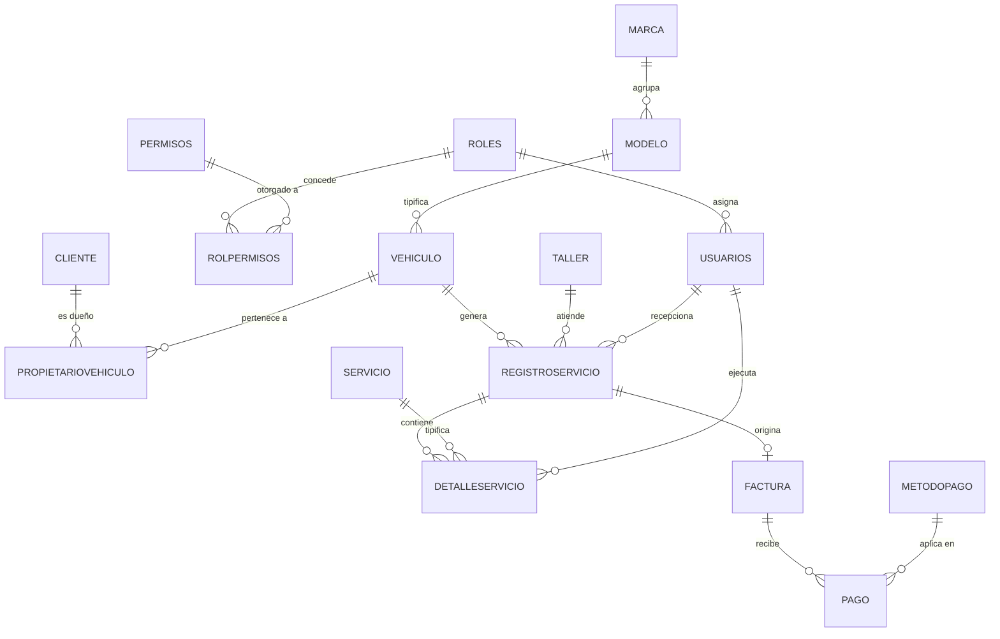

# Diagrama Entidad-Relación (DER) — Sistema de Control Vehicular

> **Versión:** final · **Fecha:** 2026-10-12
> Documento vigente y **autoritativo**. Refleja el modelo real de **18 tablas** en SQL Server.
> La versión 1 (con nombres *legacy* en `snake_case` y entidades que nunca llegaron al modelo) quedó archivada en `docs/historico/DER_v1.md` y **no debe usarse** como referencia.

La fuente de verdad de este documento es el DDL canónico `bd/01_Estructura.sql` (consolidado 2026-10-12), las entidades de `Entidad/` y las configuraciones de `Datos/Configuracion/`. Cuando exista duda, prevalece el DDL.

---

## 1. Alcance

El modelo cubre los siguientes dominios:

- **Seguridad y acceso**: roles, permisos y usuarios (RBAC).
- **Clientes y parque automotor**: clientes, marcas, modelos, vehículos y el histórico de propiedad.
- **Operación de taller**: talleres, catálogo de servicios y órdenes de servicio con sus tareas.
- **Facturación y cobros**: facturas, métodos de pago y pagos.
- **Configuración**: datos de la empresa emisora y parámetros de respaldo.

---

## 2. Entidades y atributos

### 2.1 Seguridad y usuarios

#### Roles
| Campo | Tipo (SQL Server) | Clave | Descripción |
| :--- | :--- | :--- | :--- |
| `Id` | `int` | **PK** | Identificador del rol. |
| `Nombre` | `nvarchar(max)` | | Nombre del rol (Administrador, Recepcionista, Mecánico). |
| `Descripcion` | `nvarchar(max)` | | Descripción de responsabilidades. |
| `Estado` | `bit` | | Rol habilitado/inhabilitado (por defecto activo). |

#### Permisos
| Campo | Tipo (SQL Server) | Clave | Descripción |
| :--- | :--- | :--- | :--- |
| `IdPermiso` | `int` | **PK** | Identificador del permiso. |
| `Nombre` | `nvarchar(100)` | | Clave del permiso (p. ej. `Cliente.Crear`, `Reporte.Gerencial.Ver`). |

#### Usuarios
| Campo | Tipo (SQL Server) | Clave | Descripción |
| :--- | :--- | :--- | :--- |
| `Id` | `int` | **PK** | Identificador del usuario. |
| `RolId` | `int` | **FK** → `Roles.Id` | Rol asignado. |
| `Nombre` | `nvarchar(100)` | | Nombre(s). |
| `Apellido` | `nvarchar(100)` | | Apellido(s). |
| `Dni` | `nvarchar(15)` | UNIQUE | Documento de identidad (único). |
| `Email` | `nvarchar(100)` | UNIQUE | Correo electrónico (único). |
| `Telefono` | `nvarchar(20)` | | Teléfono de contacto. |
| `Domicilio` | `nvarchar(200)` | | Domicilio. |
| `FechaNacimiento` | `datetime2` | | Fecha de nacimiento. |
| `Contrasena` | `nvarchar(max)` | | Credencial de acceso (hash/almacenada). |
| `Estado` | `bit` | | Cuenta habilitada/inhabilitada (por defecto activa). |

#### RolPermisos
| Campo | Tipo (SQL Server) | Clave | Descripción |
| :--- | :--- | :--- | :--- |
| `IdRol` | `int` | **PK/FK** → `Roles.Id` | Rol. |
| `IdPermiso` | `int` | **PK/FK** → `Permisos.IdPermiso` | Permiso concedido al rol. |

> Tabla intermedia de la relación N:M entre `Roles` y `Permisos`. No tiene clase de entidad propia: se mapea en `CVDbContext` mediante `UsingEntity` y existe como tabla explícita en el DDL.

---

### 2.2 Clientes y parque automotor

#### Cliente
| Campo | Tipo (SQL Server) | Clave | Descripción |
| :--- | :--- | :--- | :--- |
| `Id` | `int` | **PK** | Identificador del cliente. |
| `Nombre` | `nvarchar(100)` | | Nombre(s). |
| `Apellido` | `nvarchar(100)` | | Apellido(s). |
| `Dni` | `nvarchar(8)` | | Documento de identidad. |
| `FechaNacimiento` | `datetime2` | | Fecha de nacimiento. |
| `Direccion` | `nvarchar(200)` | | Domicilio. |
| `Email` | `nvarchar(max)` | | Correo electrónico de contacto. |
| `Telefono` | `nvarchar(max)` | | Teléfono de contacto. |
| `Activo` | `bit` | | Estado del registro de cliente. |

#### Marca
| Campo | Tipo (SQL Server) | Clave | Descripción |
| :--- | :--- | :--- | :--- |
| `Id` | `int` | **PK** | Identificador de la marca. |
| `NombreMarca` | `nvarchar(100)` | | Denominación de la marca (p. ej. Volkswagen, Ford). |

#### Modelo
| Campo | Tipo (SQL Server) | Clave | Descripción |
| :--- | :--- | :--- | :--- |
| `Id` | `int` | **PK** | Identificador del modelo. |
| `MarcaId` | `int` | **FK** → `Marca.Id` | Marca fabricante. |
| `NombreModelo` | `nvarchar(100)` | | Denominación del modelo. |

#### Vehiculo
| Campo | Tipo (SQL Server) | Clave | Descripción |
| :--- | :--- | :--- | :--- |
| `Id` | `int` | **PK** | Identificador de la unidad. |
| `ModeloId` | `int` | **FK** → `Modelo.Id` | Modelo del vehículo. |
| `Anio` | `int` | | Año de fabricación. |
| `Patente` | `nvarchar(15)` | | Dominio/patente. |
| `KmActual` | `int` | | Kilometraje acumulado (CHECK ≥ 0). |

#### PropietarioVehiculo
| Campo | Tipo (SQL Server) | Clave | Descripción |
| :--- | :--- | :--- | :--- |
| `Id` | `int` | **PK** | Identificador de la asignación de propiedad. |
| `ClienteId` | `int` | **FK** → `Cliente.Id` | Cliente propietario. |
| `VehiculoId` | `int` | **FK** → `Vehiculo.Id` | Vehículo adquirido. |
| `FechaAdquisicion` | `datetime2` | | Fecha de adquisición (por defecto `GETDATE()`). |
| `FechaVenta` | `datetime2` (nulo) | | Fecha de venta; `NULL` si es el dueño actual. |
| `EsActual` | `bit` | | Marca el dueño vigente (por defecto `1`). |

> Resuelve la relación N:M entre `Cliente` y `Vehiculo`, conservando el **histórico de dueños** de cada unidad.

---

### 2.3 Talleres, servicios y operación

#### Taller
| Campo | Tipo (SQL Server) | Clave | Descripción |
| :--- | :--- | :--- | :--- |
| `Id` | `int` | **PK** | Identificador del taller/sucursal. |
| `Nombre` | `nvarchar(100)` | | Nombre del taller. |
| `Direccion` | `nvarchar(200)` | | Ubicación física. |
| `Telefono` | `nvarchar(20)` | | Teléfono de contacto. |
| `Activo` | `bit` | | Taller habilitado/deshabilitado. |

#### Servicio
| Campo | Tipo (SQL Server) | Clave | Descripción |
| :--- | :--- | :--- | :--- |
| `Id` | `int` | **PK** | Identificador del tipo de servicio. |
| `Nombre` | `nvarchar(150)` | | Descripción de la tarea (CHECK de precio > 0 sobre `Precio`). |
| `Precio` | `decimal(18,2)` | | Tarifa base unitaria (CHECK > 0). |
| `Activo` | `bit` | | Disponibilidad en el catálogo (por defecto activo). |

#### RegistroServicio
| Campo | Tipo (SQL Server) | Clave | Descripción |
| :--- | :--- | :--- | :--- |
| `Id` | `int` | **PK** | Orden de servicio (ingreso al taller). |
| `VehiculoId` | `int` | **FK** → `Vehiculo.Id` | Vehículo atendido. |
| `TallerId` | `int` | **FK** → `Taller.Id` | Taller donde se efectúa. |
| `UsuarioId` | `int` | **FK** → `Usuarios.Id` | Usuario/operador que recepciona. |
| `Fecha` | `datetime2` | | Fecha de ingreso. |
| `KmIngreso` | `int` | | Kilometraje al ingresar (CHECK ≥ 0). |
| `Estado` | `nvarchar(50)` | | Estado de la orden (CHECK: `Abierta`, `En Proceso`, `Completada`, `Pagada`, `Cancelada`). |

#### DetalleServicio
| Campo | Tipo (SQL Server) | Clave | Descripción |
| :--- | :--- | :--- | :--- |
| `Id` | `int` | **PK** | Renglón/tarea dentro de la orden. |
| `RegistroServicioId` | `int` | **FK** → `RegistroServicio.Id` | Orden cabecera. |
| `UsuarioId` | `int` | **FK** → `Usuarios.Id` | Técnico que ejecuta/confecciona. |
| `ServicioId` | `int` | **FK** → `Servicio.Id` | Servicio/tarea aplicada. |
| `Cantidad` | `int` | | Cantidad aplicada (CHECK > 0). |
| `Precio` | `decimal(18,2)` | | Precio unitario acordado (CHECK ≥ 0). |
| `OrdenEjecucion` | `int` | | Orden de ejecución (por defecto `1`). |
| `Origen` | `nvarchar(100)` | | Origen del ítem (p. ej. `Taller`). |
| `Estado` | `nvarchar(50)` | | Estado del ítem (CHECK: `Pendiente`, `En Curso`, `Finalizada`). |
| `Observaciones` | `nvarchar(max)` | | Notas del renglón. |

---

### 2.4 Facturación y pagos

#### Factura
| Campo | Tipo (SQL Server) | Clave | Descripción |
| :--- | :--- | :--- | :--- |
| `Id` | `int` | **PK** | Identificador del comprobante. |
| `RegistroServicioId` | `int` | **FK/UNIQUE** → `RegistroServicio.Id` | Orden facturada (una factura por orden). |
| `Numero` | `int` | | Número consecutivo (`DEFAULT NEXT VALUE FOR Seq_Factura_Numero`). |
| `Fecha` | `datetime2` | | Fecha de emisión. |
| `Total` | `decimal(10,2)` | | Importe liquidado. |

#### MetodoPago
| Campo | Tipo (SQL Server) | Clave | Descripción |
| :--- | :--- | :--- | :--- |
| `Id` | `int` | **PK** | Identificador del medio de pago. |
| `Nombre` | `nvarchar(50)` | | Nombre del método (p. ej. Efectivo, Tarjeta). |

#### Pago
| Campo | Tipo (SQL Server) | Clave | Descripción |
| :--- | :--- | :--- | :--- |
| `Id` | `int` | **PK** | Identificador de la transacción. |
| `FacturaId` | `int` | **FK** → `Factura.Id` | Factura asociada. |
| `MetodoPagoId` | `int` | **FK** → `MetodoPago.Id` | Medio utilizado. |
| `Monto` | `decimal(10,2)` | | Importe abonado. |
| `FechaPago` | `datetime2` | | Fecha del pago. |

---

### 2.5 Configuración

#### ConfiguracionEmpresa
| Campo | Tipo (SQL Server) | Clave | Descripción |
| :--- | :--- | :--- | :--- |
| `Id` | `int` | **PK** | Fila única (singleton, `Id = 1`). |
| `Nombre` | `nvarchar(100)` | | Razón social / nombre de fantasía. |
| `Direccion` | `nvarchar(200)` | | Domicilio. |
| `Telefono` | `nvarchar(20)` | | Teléfono. |
| `Email` | `nvarchar(150)` (nulo) | | Correo de contacto. |
| `Logo` | `varbinary(max)` (nulo) | | Logo usado en reportes/comprobantes. |
| `FechaActualizacion` | `datetime2` | | Última modificación. |

#### ConfiguracionBackup
| Campo | Tipo (SQL Server) | Clave | Descripción |
| :--- | :--- | :--- | :--- |
| `Id` | `int` | **PK** | Fila única (singleton, `Id = 1`). |
| `NombreBaseDatos` | `nvarchar(128)` | | Nombre de la base (por defecto `ControlVehicular`). |
| `RutaBackupServer` | `nvarchar(260)` | | Ruta local del respaldo en el servidor. |
| `RutaBackupUNC` | `nvarchar(260)` | | Ruta compartida (UNC). |
| `DriveFolderId` | `nvarchar(260)` (nulo) | | ID de carpeta de Google Drive. |
| `UltimaSubidaArchivo` | `nvarchar(260)` (nulo) | | Nombre del último archivo subido. |
| `FechaUltimaSubida` | `datetime2` (nulo) | | Fecha de la última subida. |
| `FechaActualizacion` | `datetime2` | | Última modificación. |

---

## 3. Relaciones y cardinalidades

| Entidad origen | Relación | Entidad destino | Cardinalidad | Detalle |
| :--- | :--- | :--- | :--- | :--- |
| `Roles` | asigna | `Usuarios` | 1 a N | Un rol puede pertenecer a muchos usuarios. |
| `Roles` | concede | `Permisos` | N a M | Vía `RolPermisos`. |
| `Marca` | agrupa | `Modelo` | 1 a N | Una marca tiene múltiples modelos. |
| `Modelo` | tipifica | `Vehiculo` | 1 a N | Un modelo agrupa muchos vehículos. |
| `Cliente` | es propietario de | `Vehiculo` | N a M | Vía `PropietarioVehiculo` (con histórico). |
| `Vehiculo` | genera | `RegistroServicio` | 1 a N | Una unidad acumula múltiples órdenes en el tiempo. |
| `Taller` | atiende | `RegistroServicio` | 1 a N | Un taller procesa muchas órdenes. |
| `Usuarios` | recepciona | `RegistroServicio` | 1 a N | Un operador abre múltiples órdenes. |
| `RegistroServicio` | contiene | `DetalleServicio` | 1 a N | Una orden agrupa una o más tareas. |
| `Servicio` | tipifica | `DetalleServicio` | 1 a N | Un ítem del catálogo aparece en muchos renglones. |
| `Usuarios` | ejecuta | `DetalleServicio` | 1 a N | Un técnico registra múltiples renglones. |
| `RegistroServicio` | origina | `Factura` | 1 a 0..1 | Una orden emite a lo sumo una factura (`RegistroServicioId` es único). |
| `Factura` | recibe | `Pago` | 1 a N | Una factura puede tener uno o varios pagos. |
| `MetodoPago` | aplica en | `Pago` | 1 a N | Un método se usa en muchos pagos. |

---

## 4. Diagrama entidad-relación

> `ConfiguracionEmpresa` y `ConfiguracionBackup` son tablas *singleton* aisladas, sin relaciones con el resto del modelo.

---

## 5. Notas

1. **Consistencia de kilometraje.** El trigger `TR_RegistroServicio_SincronizarKm` actualiza `Vehiculo.KmActual` al insertar una orden y rechaza la operación si `KmIngreso` es menor al `KmActual` registrado.
2. **Precio histórico.** `DetalleServicio.Precio` es una copia (*snapshot*) del valor vigente de `Servicio.Precio` al momento de la intervención, para no descalzar importes ante futuros cambios de tarifa.
3. **Validación de pagos.** Los triggers `TR_DetalleServicio_ValidarPrecioYCantidad` y `TR_DetalleServicio_BloquearModificacionFinalizada` protegen la integridad de los renglones y bloquean la edición de órdenes ya facturadas.
4. **Estados canónicos.** `RegistroServicio.Estado` ∈ {`Abierta`, `En Proceso`, `Completada`, `Pagada`, `Cancelada`}; `DetalleServicio.Estado` ∈ {`Pendiente`, `En Curso`, `Finalizada`}. Ambas listas se validan con CHECK en la base.
5. **Numeración de facturas.** `Factura.Numero` no es `IDENTITY`: toma su valor de la secuencia `Seq_Factura_Numero`.
6. **Unicidad de factura.** `IX_Factura_RegistroServicioId` es único: cada orden de servicio puede facturarse una sola vez.
7. **Propiedad independiente.** Un vehículo puede existir sin cliente asignado; la relación de propiedad se registra en `PropietarioVehiculo` para conservar el historial de dueños ante ventas.
8. **RBAC.** Los permisos denegados implícitamente: un rol solo puede ejecutar las acciones cuyos permisos figuren en `RolPermisos`. Los reportes usan permisos granulares (`Reporte.<Nombre>.Ver`); el permiso genérico `Reporte.Ver` es obsoleto.
