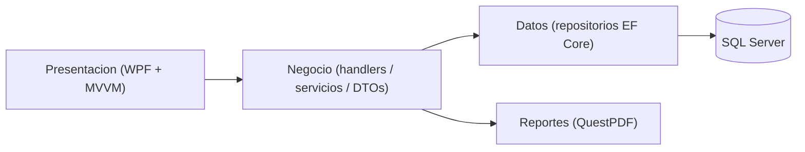

# 📚 Manuales de TP_ControlVehicular (Taller Pro)

Bienvenido a la **documentación oficial** del sistema de control vehicular y gestión de taller **TP_ControlVehicular** (nombre comercial *Taller Pro*). Este portal es el punto de entrada a los manuales; desde aquí puede navegar al manual que corresponda a su rol.

> [!NOTE]
> Toda la documentación está en español y en formato Markdown. Las imágenes se referencian con rutas relativas (`assets/roles/...` y `assets/tecnico/...`); el repositorio incluye **marcadores de captura** (`> 📸 CAPTURA REQUERIDA:`) que indican qué pantalla fotografiar, en qué estado y qué resaltar. Las capturas `.png` se agregan luego en las mismas rutas.

---

## 1. ¿Qué es el sistema?

**TP_ControlVehicular** es una aplicación de escritorio **WPF (.NET 10)** para la gestión integral de un taller mecánico:

- **Órdenes de servicio** con detalle de tareas por mecánico, estados y cobro.
- **Clientes** y **vehículos** (con marcas y modelos), incluyendo el alta rápida de vehículos por patente.
- **Servicios** (catálogo de trabajos), **talleres** y **usuarios/roles** con permisos.
- **Dashboard** adaptado a cada perfil y **reportes** (Órdenes, Gerencial, Operativo).
- **Respaldos** de base de datos con resguardo opcional en **Google Drive**.

---

## 2. Arquitectura general

La solución está organizada en **capas** (arquitectura N-capas) y la interfaz sigue el patrón **MVVM**:

```text
TP_ControlVehicular/
├── Entidad/        → Entidades del dominio (Marca, Cliente, Modelo, Vehiculo, ...)
├── Datos/          → Acceso a datos: CVDbContext, Repository<T>, repositorios por entidad
├── Migracion/      → Migraciones EF Core y snapshot del modelo
├── Negocio/        → Reglas de negocio: handlers, DTOs, AutoMapper, servicios, reportes
└── Presentacion/   → UI WPF: ViewModels (MVVM), UserControls (Ctl*) y ventanas modales (Frm*)
```

- **Base de datos:** SQL Server (EF Core 10, `Microsoft.EntityFrameworkCore.SqlServer`).
- **Inyección de dependencias:** `Microsoft.Extensions.DependencyInjection`/Hosting, configurada en `App.xaml.cs`.
- **Mapeo de objetos:** AutoMapper (perfil unidireccional Entidad→DTO).
- **Reportes PDF:** QuestPDF.
- **Tests:** proyecto `TP_ControlVehicular.Tests` (xUnit + Moq).



---

## 3. Perfiles del sistema

El acceso a los módulos depende del **rol** del usuario autenticado (RBAC). El sistema define tres roles base:

| Rol | Badge | Enfoque |
|---|---|---|
| **Administrador** | 🛡️ | Control total: catálogos, usuarios/roles, empresa, respaldos y reportes. |
| **Recepcionista** | 📋 | Atención al cliente: clientes, vehículos, órdenes de servicio y cobro. |
| **Mecánico** | 🔧 | Trabajo operativo: sus tareas asignadas (*Mis Trabajos*) y avance de órdenes. |

---

## 4. Matriz de perfiles × módulos

La siguiente matriz refleja la **visibilidad real del menú lateral** (`MainWindow.xaml.cs → AplicarRestriccionesPorRol`) y los permisos asignados por los scripts de `bd/`.

| Módulo (menú) | Permiso requerido | 🛡️ Admin | 📋 Recepción | 🔧 Mecánico |
|---|---|:--:|:--:|:--:|
| 📊 Dashboard | *(siempre visible)* | ✅ | ✅ | ✅ |
| 📋 Órdenes de Trabajo | `OrdenServicio.Ver` | ✅ | ✅ | ✅ |
| 🔧 Mis Trabajos | `MisTrabajos.Ver` | ❌ | ❌ | ✅ |
| 📦 Servicios | `Servicio.Ver` | ✅ | ✅ | ✅ |
| 👤 Clientes | `Cliente.Ver` | ✅ | ✅ | ✅ |
| 🚗 Vehículos | `Vehiculo.Ver` | ✅ | ✅ | ✅ |
| 🗂️ Modelos de Autos | `Vehiculo.Ver` | ✅ | ✅ | ✅ |
| 🏷️ Marcas | `Vehiculo.Ver` | ✅ | ✅ | ✅ |
| 🔧 Talleres | `Taller.Ver` | ✅ | ❌ | ❌ |
| 🔑 Usuarios | `Usuario.Ver` | ✅ | ❌ | ❌ |
| 🛡️ Roles | `Usuario.Ver` | ✅ | ❌ | ❌ |
| 🏢 Configuración de Empresa | `Configuracion.Empresa.Gestionar` | ✅ | ❌ | ❌ |
| 💾 Respaldos | `Configuracion.Backup.Gestionar` | ✅ | ❌ | ❌ |
| 🗄️ Configuración de Respaldos | `Configuracion.Backup.Gestionar` | ✅ | ❌ | ❌ |
| 📋 Reporte Órdenes | `Reporte.Ordenes.Ver` | ✅ | ✅ | ❌ |
| 📈 Reporte Gerencial | `Reporte.Gerencial.Ver` | ✅ | ❌ | ❌ |
| 🚙 Reporte Operativo | `Reporte.Operativo.Ver` | ✅ | ✅ | ❌ |
| ❌ Cerrar Sesión | *(siempre visible)* | ✅ | ✅ | ✅ |

> [!IMPORTANT]
> *Mis Trabajos* es una pantalla **exclusiva del Mecánico** (el Administrador no la ve); la asignación se controla en el seed de `bd/04_datos.sql`.
> Mientras un rol carezca de todos los permisos de una sección, la sección del menú (*OPERACIONES*, *ADMINISTRACIÓN*, *REPORTES*) se oculta automáticamente.

---

## 5. Mapa de navegación

| Documento | Audiencia | Contenido |
|---|---|---|
| 👉 [**Manual de Usuario Operativo**](manual_usuario_roles.md) | Administrador, Recepcionista, Mecánico | Primeros pasos, capítulos por rol, flujos paso a paso, dudas y errores frecuentes. |
| 👉 [**Manual Técnico de Administración y TI**](manual_tecnico_administracion.md) | TI / Soporte | Infraestructura, conexión SQL Server, scripts `bd/`, respaldos + Google Drive, recuperación ante desastres y troubleshooting. |

---

## 6. Convención de capturas de pantalla

Cada pantalla, formulario, diálogo o paso relevante incluye un **marcador** con la ruta de su imagen. Formato:

```markdown
> 📸 **CAPTURA REQUERIDA:** `docs/manuales/assets/<carpeta>/<archivo>.png`
> - **Pantalla / Modal:** <Nombre visible y control XAML, ej: CtlOrdenServicioForm>
> - **Estado recomendado:** <datos de ejemplo cargados>
> - **Elementos a resaltar:** <botones/recuadros>
> - **Epígrafe:** *Figura X.X: <descripción>*


```

- **Carpetas:** `assets/roles/` (manual operativo) y `assets/tecnico/` (manual técnico).
- **Nomenclatura sugerida:** `NN-modulo[-variante].png` (ej. `01-login.png`, `05-orden-servicio-form.png`).
- Las imágenes se guardan en la ruta indicada; el enlace `` se resuelve **relativo al `.md`**.

---

## 7. Preguntas frecuentes rápidas

<details>
<summary>¿Qué hago si no veo un módulo en el menú?</summary>

El menú es dinámico según su rol. Si un módulo no aparece, su rol no tiene el permiso correspondiente. Consulte a un Administrador. Ver *Matriz de perfiles × módulos* (sección 4).
</details>

<details>
<summary>¿Dónde se configuran los respaldos?</summary>

Como Administrador, en **💾 Respaldos** y **🗄️ Configuración de Respaldos**. El detalle técnico está en el [Manual Técnico](manual_tecnico_administracion.md).
</details>

<details>
<summary>Soy de TI, ¿por dónde empiezo?</summary>

Por el [Manual Técnico de Administración y TI](manual_tecnico_administracion.md): requisitos → conexión SQL → scripts `bd/` → respaldos → recuperación.
</details>
