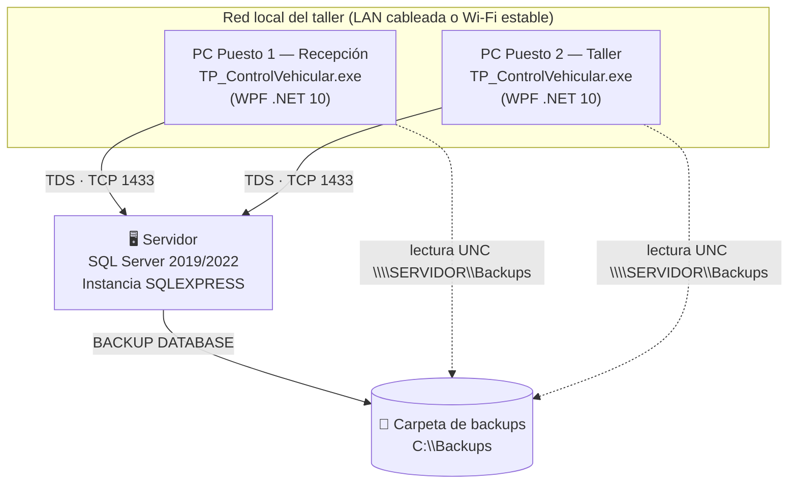
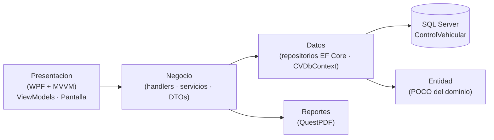
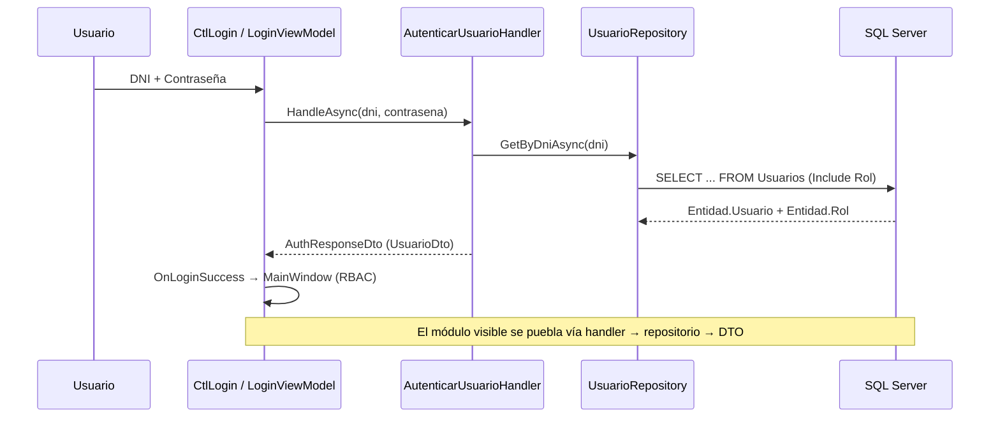

# 🛠️ Manual Técnico de Administración y TI — TP_ControlVehicular

> **Audiencia:** Administradores de sistemas, personal de soporte técnico y responsables de infraestructura que **instalan, configuran y mantienen** el sistema `TP_ControlVehicular` (nombre comercial *Taller Pro*).
> **Alcance:** infraestructura, base de datos SQL Server, conectividad, respaldos + Google Drive, recuperación ante desastres, permisos NTFS y diagnóstico.
> **Manual complementario:** para el uso funcional por rol, ver [`manual_usuario_roles.md`](manual_usuario_roles.md).

| Dato | Valor |
|---|---|
| Producto | TP_ControlVehicular (*Taller Pro*) |
| Tipo | Aplicación de escritorio WPF (cliente–servidor) |
| Plataforma | .NET 10.0 (WinExe) · WPF · MVVM |
| Base de datos | Microsoft SQL Server (EF Core 10) |
| Instancia de referencia | `<SERVIDOR>\<INSTANCIA>` |
| Base de datos de referencia | `ControlVehicular` |
| Repositorio | Monorepo único (`Entidad/`, `Datos/`, `Migracion/`, `Negocio/`, `Presentacion/`, `bd/`, `docs/`, `openspec/`) |

### Parámetros de la instalación

Esta guía usa marcadores genéricos para no exponer valores de un entorno concreto. Sustitúyelos por los de tu instalación:

| Marcador | Significado | Valor de ejemplo |
|---|---|---|
| `<SERVIDOR>` | Nombre del equipo o servidor | `SRV-TALLER` |
| `<INSTANCIA>` | Instancia de SQL Server | `SQLEXPRESS` |
| `<RUTA_BACKUPS>` | Carpeta de respaldos | `C:\Backups` |
| `<RUTA_DATOS>` | Carpeta de datos | `C:\Data` |
| `<DOMINIO>` | Dominio o equipo de usuarios | `TALLER\Usuarios` |

> [!NOTE]
> **Convención de capturas.** Cada paso relevante incluye un marcador `> 📸 **CAPTURA REQUERIDA:**` con la ruta de su imagen. El administrador toma las capturas reales durante la puesta en marcha y las guarda en `docs/manuales/assets/tecnico/` con la nomenclatura `NN-modulo[-variante].png`. El enlace `` se resuelve **relativo a este archivo**.

---

## Índice

1. [Arquitectura y requisitos del entorno](#capítulo-1--arquitectura-y-requisitos-del-entorno)
2. [Instalación, despliegue y conectividad](#capítulo-2--instalación-despliegue-y-conectividad)
3. [Base de datos: creación, scripts `bd/` y verificación](#capítulo-3--base-de-datos-creación-scripts-bd-y-verificación)
4. [Sistema de respaldos y resguardo en Google Drive](#capítulo-4--sistema-de-respaldos-y-resguardo-en-google-drive)
5. [Recuperación ante desastres (Disaster Recovery)](#capítulo-5--recuperación-ante-desastres-disaster-recovery)
6. [Carpetas, permisos NTFS y seguridad](#capítulo-6--carpetas-permisos-ntfs-y-seguridad)
7. [Operación y administración](#capítulo-7--operación-y-administración)
8. [Diagnóstico y solución de problemas (Troubleshooting)](#capítulo-8--diagnóstico-y-solución-de-problemas-troubleshooting)
9. [Mantenimiento, evolución y control de versiones](#capítulo-9--mantenimiento-evolución-y-control-de-versiones)
10. [Apéndices](#apéndices)

---

## Capítulo 1 — Arquitectura y requisitos del entorno

### 1.1 Topología de despliegue

El despliegue objetivo es **cliente–servidor para un taller mecánico**: **dos puestos de trabajo** (PC de recepción y PC de taller) que se conectan por red local a una **única instancia central de SQL Server**. **No se utiliza LocalDB**: la base de datos vive siempre en la instancia central para garantizar consistencia y respaldo único.



> 📸 **CAPTURA REQUERIDA:** `docs/manuales/assets/tecnico/01-topologia-despliegue.png`
> - **Pantalla / Modal:** Diagrama de topología de despliegue (servidor + 2 puestos) tal como quedó implementado en el taller.
> - **Estado recomendado:** Mostrar el servidor con la instancia `<INSTANCIA>`, los dos puestos cliente y la carpeta de respaldos compartida.
> - **Elementos a resaltar:** Instancia SQL (recuadro rojo), puerto TCP 1433 y la ruta UNC `\\SERVIDOR\Backups`.
> - **Epígrafe:** *Figura 1.1: Topología cliente–servidor del despliegue en el taller.*


### 1.2 Arquitectura de capas

La solución está organizada en **capas** (arquitectura N-capas) y la interfaz sigue el patrón **MVVM**. Cada capa tiene una responsabilidad acotada:



| Capa | Carpeta / Namespace | Responsabilidad |
|---|---|---|
| Presentación (UI & MVVM) | `Presentacion/` (`ViewModels/`, `Pantalla/`) | Vistas WPF (UserControls/Windows), DataBinding y ViewModels con `BaseViewModel`. |
| Negocio & Servicios | `Negocio/` (`Handlers/`, `Services/`, `DTOs/`, `MappingProfile`) | Handlers de comandos/consultas, DTOs y perfil de mapeo AutoMapper. |
| Acceso a Datos (DAL) | `Datos/` (`Repositories/`, `Data/CVDbContext`) | Repositorios genéricos y específicos, contexto EF Core. |
| Entidades & Base de Datos | `Entidad/` y SQL Server | Clases POCO del dominio y base de datos relacional SQL Server. |
| Migraciones | `Migracion/` | Migraciones EF Core y snapshot del modelo. |

### 1.3 Flujo de llamadas (login → vista)

Interacciones clave entre capas al iniciar sesión y cargar un módulo (patrón MVVM + DI):



**Composición de dependencias (`App.xaml.cs`):** la configuración se lee desde `appsettings.json` con `SetBasePath(AppContext.BaseDirectory)`; se registran `DbContext` (Transient), repositorios y handlers (`AddScoped`), ViewModels (`AddScoped`) y la `MainWindow` (Singleton). La licencia de QuestPDF (Community) se fija al arranque.

### 1.4 Requisitos de software y hardware

**Software**

| Componente | Requisito |
|---|---|
| Sistema operativo | Windows 10 / 11 (64-bit) o Windows Server (2019 / 2022). |
| Runtime de escritorio | **Microsoft .NET Desktop Runtime 10.0 (x64)** — necesario para ejecutar el `.exe` publicado. |
| Motor de base de datos | **Microsoft SQL Server 2019 / 2022** (Express, Standard o superior) en el servidor. |
| SDK (solo desarrollo) | .NET SDK 10.0. |
| Navegador web | Necesario en el puesto que configure Google Drive (autorización OAuth). |
| Conectividad | Red local cableada o Wi-Fi estable, con resolución de nombres o **IP fija** en el servidor. |

**Hardware (recomendado)**

| Rol | CPU | RAM | Disco |
|---|---|---|---|
| Servidor SQL | 4 vCPU | 8 GB | SSD, con espacio libre ≥ 3× el tamaño de la base (respaldos) |
| Puesto cliente | 2 vCPU | 4 GB | 5 GB libres (ejecutable + temporales de reportes) |

> 📸 **CAPTURA REQUERIDA:** `docs/manuales/assets/tecnico/02-requisitos-runtime.png`
> - **Pantalla / Modal:** `dotnet --info` en la consola o panel *Aplicaciones instaladas* de Windows mostrando el **.NET Desktop Runtime 10.0 (x64)**.
> - **Estado recomendado:** Listar la versión del runtime instalado en el servidor o en un puesto cliente.
> - **Elementos a resaltar:** Versión `10.0.x` y arquitectura `x64` (recuadro rojo).
> - **Epígrafe:** *Figura 1.2: Verificación del Microsoft .NET Desktop Runtime 10.0 (x64).*


---

## Capítulo 2 — Instalación, despliegue y conectividad

### 2.1 Instalación de requisitos previos

1. **Servidor:** instalar SQL Server 2019/2022 (típicamente edición **Express**) con la instancia nombrada `<INSTANCIA>`. Registrar la cuenta de servicio (por defecto `NT Service\MSSQL$<INSTANCIA>`).
2. **Servidor y clientes:** instalar el **Microsoft .NET Desktop Runtime 10.0 (x64)**.
3. **Clientes:** no requieren SQL Server local; consumen la instancia central.

### 2.2 Publicación de la aplicación

La aplicación se compila y publica en modo **Release** para obtener la carpeta de despliegue:

```bash
# Compilar la solución completa
dotnet build "TP_ControlVehicular.slnx"

# Publicar (ejemplo: carpeta de salida en el servidor de despliegue)
dotnet publish "TP_ControlVehicular.csproj" -c Release -r win-x64 --self-contained false -o "C:\Deploy\TP_ControlVehicular"
```

Los artefactos resultantes (`TP_ControlVehicular.exe`, `appsettings.json`, dependencias e `assets`) se copian a cada puesto de trabajo. La configuración se lee desde `appsettings.json`, ubicado **junto al ejecutable**.

> [!TIP]
> Si se desea un instalador autocontenido (sin runtime previo), publicar con `--self-contained true`. Para el despliegue de taller con runtime instalado, `--self-contained false` reduce el tamaño.

### 2.3 Cadena de conexión (`appsettings.json`)

La aplicación lee la cadena de conexión `DefaultConnection` desde `appsettings.json`, en la carpeta de salida del ejecutable (`AppContext.BaseDirectory`):

```json
{
  "ConnectionStrings": {
    "DefaultConnection": "Server=<SERVIDOR>\\<INSTANCIA>;Database=ControlVehicular;Trusted_Connection=True;TrustServerCertificate=True;MultipleActiveResultSets=true"
  }
}
```

| Parámetro | Significado | Nota de despliegue |
|---|---|---|
| `Server` | Equipo + instancia (`<SERVIDOR>\<INSTANCIA>`). | Apuntar al **servidor central** del taller. |
| `Database` | Base de datos de trabajo. | `ControlVehicular`. |
| `Trusted_Connection=True` | Autenticación **Windows** (Integrated Security). | La cuenta de Windows del usuario del puesto debe existir como login en SQL. |
| `TrustServerCertificate=True` | Omite la validación del certificado TLS del servidor. | Necesario con certificados autofirmados en la LAN. |
| `MultipleActiveResultSets=true` | Varios `DataReader` activos por conexión. | Mejora la carga de grids con relaciones. |

> [!IMPORTANT]
> En producción, `Server=` debe apuntar al **servidor** (no a `localhost`) y `Trusted_Connection=True` exige que la cuenta de Windows del usuario tenga login y permisos en SQL Server. Para autenticación SQL (usuario/contraseña), reemplazar por `User Id=...;Password=...;`.

> 📸 **CAPTURA REQUERIDA:** `docs/manuales/assets/tecnico/03-appsettings-config.png`
> - **Pantalla / Modal:** `appsettings.json` abierto en un editor (con la cadena apuntando al servidor del taller).
> - **Estado recomendado:** Mostrar la sección `ConnectionStrings:DefaultConnection` completa.
> - **Elementos a resaltar:** `Server=`, `Database=`, `Trusted_Connection=True`, `TrustServerCertificate=True` (recuadro rojo).
> - **Epígrafe:** *Figura 2.1: Cadena de conexión `DefaultConnection` en `appsettings.json`.*


### 2.4 Habilitación de red en SQL Server (TCP/IP y puerto 1433)

Por defecto, SQL Server Express puede tener el protocolo **TCP/IP deshabilitado** y usar **puertos dinámicos**, lo que impide la conexión desde los puestos. Procedimiento en el **servidor**:

1. Abrir **SQL Server Configuration Manager** (`SQLServerManager<versión>.msc`).
2. Ir a **SQL Server Network Configuration → Protocols for <INSTANCIA>**.
3. Habilitar el protocolo **TCP/IP** (Properties → *Protocol* → `Enabled = Yes` → reiniciar el servicio).
4. En la pestaña **IP Addresses → IPAll**, configurar un **puerto estático**:
   - `TCP Dynamic Ports` = *(vacío)*
   - `TCP Port` = `1433`
5. **Reiniciar el servicio** `SQL Server (<INSTANCIA>)` desde el mismo administrador o con `services.msc`.

> [!NOTE]
> Con una **instancia nombrada**, los clientes resuelven el nombre `<SERVIDOR>\<INSTANCIA>` a través del **SQL Server Browser** (UDP 1434). Alternativas: (a) mantener el servicio **SQL Server Browser** en ejecución, o (b) fijar el puerto estático `1433` y usar `Server=<SERVIDOR>,1433` o un **alias de cliente** (SQL Native Client Configuration → Aliases).

> 📸 **CAPTURA REQUERIDA:** `docs/manuales/assets/tecnico/04-sql-protocolos-tcpip.png`
> - **Pantalla / Modal:** SQL Server Configuration Manager — *Protocols for <INSTANCIA>* / pestaña *IP Addresses → IPAll*.
> - **Estado recomendado:** TCP/IP en `Enabled`, `TCP Port = 1433`, `TCP Dynamic Ports` vacío.
> - **Elementos a resaltar:** Estado `Enabled` del protocolo y el puerto `1433` (recuadro rojo).
> - **Epígrafe:** *Figura 2.2: Habilitación de TCP/IP y puerto estático 1433 en SQL Server.*


### 2.5 Regla de entrada en Windows Firewall

Para que los puestos alcancen el motor de datos, abrir el **puerto TCP 1433** en el firewall del servidor:

```powershell
# Ejecutar en el SERVIDOR como Administrador
New-NetFirewallRule -DisplayName "SQL Server TCP 1433" `
    -Direction Inbound -Protocol TCP -LocalPort 1433 -Action Allow
```

Si se conserva el **SQL Server Browser** para instancias nombradas, permitir además **UDP 1434**:

```powershell
New-NetFirewallRule -DisplayName "SQL Server Browser UDP 1434" `
    -Direction Inbound -Protocol UDP -LocalPort 1434 -Action Allow
```

Verificación rápida desde un puesto cliente:

```powershell
Test-NetConnection -ComputerName "<SERVIDOR>" -Port 1433
```

> 📸 **CAPTURA REQUERIDA:** `docs/manuales/assets/tecnico/05-firewall-puerto-1433.png`
> - **Pantalla / Modal:** *Firewall de Windows Defender con seguridad avanzada* (o el resultado de `Get-NetFirewallRule`).
> - **Estado recomendado:** Regla de entrada habilitada para TCP 1433 (y UDP 1434 si aplica).
> - **Elementos a resaltar:** Nombre de la regla, dirección *Entrante*, protocolo TCP, puerto local `1433` (recuadro rojo).
> - **Epígrafe:** *Figura 2.3: Regla de entrada de Windows Firewall para el puerto TCP 1433.*


### 2.6 Autorización de acceso (SQL / Windows)

| Escenario | Configuración | Consideración |
|---|---|---|
| **Windows Auth** (por defecto) | `Trusted_Connection=True` en `appsettings.json`. | Cada cuenta de Windows de los puestos necesita un login SQL y permisos sobre `ControlVehicular`. |
| **SQL Auth** | `User Id=…;Password=…`. | Requiere habilitar *Mixed Mode* en el servidor y crear el login/usuario SQL. Las credenciales **no se versionan**: se gestionan por variables de entorno o despliegue. |

Para el módulo de respaldos, la cuenta de conexión necesita además permisos de `BACKUP DATABASE` y de creación de bases (restore) — ver *Capítulo 4* y `docs/referencia/backup-configuracion.md` §7.

### 2.7 Verificación de conectividad y troubleshooting rápido

```powershell
# 1) ¿Responde el host y el puerto?
Test-NetConnection -ComputerName "<SERVIDOR>" -Port 1433

# 2) ¿Resuelve la instancia? (local, en el servidor)
sqlcmd -S "<SERVIDOR>\<INSTANCIA>" -Q "SELECT @@VERSION;"
```

Si `Test-NetConnection` falla: revisar servicio SQL iniciado, TCP/IP habilitado, puerto correcto y regla de firewall. Si el puerto responde pero `sqlcmd` falla: revisar el login/permisos y `TrustServerCertificate`.

---

## Capítulo 3 — Base de datos: creación, scripts `bd/` y verificación

### 3.1 Creación de la base de datos

Los scripts de `bd/` son **idempotentes**: se pueden ejecutar varias veces sin duplicar objetos ni datos. El orden de aplicación es **estricto** (`01` → `22`). Se ejecutan sobre la base `ControlVehicular` desde **SQL Server Management Studio (SSMS)** o `sqlcmd`.

```sql
-- Crear la base (si no existe) y seleccionarla
IF DB_ID('ControlVehicular') IS NULL
    CREATE DATABASE [ControlVehicular];
GO
USE [ControlVehicular];
GO
```

### 3.2 Orden de ejecución de scripts (`bd/`)

| # | Script | Propósito |
|---|---|---|
| 1 | `01_Estructura.sql` | Esquema base: tablas `Cliente`, `Marca`, `Modelo`, `Vehiculo`, `Roles`, `Usuarios`, `Taller`, `Servicio`, `RegistroServicio`, `DetalleServicio`, índices y claves. |
| 2 | `02_Datos.sql` | Datos semilla: roles, usuarios, catálogos (marcas/modelos/servicios), clientes y vehículos de ejemplo. |
| 3 | `02_StoredProcedures_Reportes.sql` | Procedimientos almacenados de reportes base. |
| 4 | `03_CreateTable_Facturas.sql` | Tabla `Factura` (facturación). |
| 5 | `04_schema_billing.sql` | Esquema de cobro: `Pago`, `MetodoPago` y relaciones. |
| 6 | `05_WorkflowOrdenesServicio.sql` | Workflow de órdenes: estados canónicos y trigger `TR_DetalleServicio_BloquearModificacionFinalizada`. |
| 7 | `06_Migraciones_Manuales.sql` | Migraciones manuales de estructura. |
| 8 | `07_Reportes_Administrador.sql` | Reportes del perfil Administrador. |
| 9 | `08_Migracion_PropietarioVehiculo.sql` | Tabla `PropietarioVehiculo`. |
| 10 | `09_PermisosAvanzados.sql` | Tablas `Permisos` y `RolPermisos` + permisos avanzados. |
| 11 | `10_ConfiguracionPermisosRecepcionMecanico.sql` | Configuración de permisos para Recepción y Mecánico. |
| 12 | `11_SP_ReportesMecanico.sql` | SP de reportes del mecánico. |
| 13 | `12_PermisosReportesPorRol.sql` | Permisos `Reporte.*.Ver` por rol. |
| 14 | `13_SP_ReporteProductividadMecanicos.sql` | `sp_ReporteProductividadMecanicos` (Reporte Operativo, por tarea). |
| 15 | `14_Fix_ReporteOperativo.sql` | Correcciones del Reporte Operativo. |
| 16 | `15_Limpieza_Artefactos_TestE2E.sql` | Purga idempotente y FK-safe de artefactos de test E2E (patentes `TDD%`, clientes `EndToEnd`). |
| 17 | `16_Fix_Colision_sp_ReporteIngresos.sql` | Separa `sp_ReporteIngresos` de `sp_ReporteIngresosAdmin` (nombres distintos). |
| 18 | `17_QuitarMisTrabajosAdmin.sql` | Quita `MisTrabajos.Ver` al Administrador (pantalla exclusiva del Mecánico). |
| 19 | `18_SP_ReporteServiciosPorRango.sql` | `sp_ReporteServiciosPorRango` (Reporte Gerencial, por tarea). |
| 20 | `19_ConfiguracionEmpresa.sql` | Tabla singleton `ConfiguracionEmpresa` (identidad + logo) + fila semilla. |
| 21 | `20_PermisosConfiguracionEmpresa.sql` | Permiso `Configuracion.Empresa.Gestionar` → Admin. |
| 22 | `21_ConfiguracionBackup.sql` | Tabla singleton `dbo.ConfiguracionBackup` (`Id = 1`) + fila semilla. |
| 23 | `22_PermisosBackup.sql` | Permiso `Configuracion.Backup.Gestionar` → Admin (`IdRol = 1`). |

**Scripts auxiliares (no numerados):**

| Script | Propósito |
|---|---|
| `BD_role_usuarios_script.sql` | Utilidades de roles/usuarios (referencia). **No** es la fuente de datos real; los usuarios productivos provienen de `02_Datos.sql`. |
| `sp_GenerarComprobanteOrden.sql` | SP de comprobante de orden. |
| `sp_GenerarComprobantePago.sql` | SP de comprobante de pago. |

> [!WARNING]
> **No editar scripts ya aplicados.** Un permiso o SP nuevo = **script nuevo** (no modificar los existentes). Los cambios de esquema administrados por EF Core viven en `Migracion/`, no en `bd/`.

> 📸 **CAPTURA REQUERIDA:** `docs/manuales/assets/tecnico/06-ssms-ejecucion-scripts.png`
> - **Pantalla / Modal:** SSMS ejecutando los scripts `bd/` (pestañas con `01_Estructura.sql` … `22_PermisosBackup.sql`) o un bucle `sqlcmd`.
> - **Estado recomendado:** Mostrar la ejecución sin errores y el mensaje *Commands completed successfully*.
> - **Elementos a resaltar:** Nombre del script (recuadro rojo) y el resultado de ejecución.
> - **Epígrafe:** *Figura 3.1: Ejecución de los scripts idempotentes de `bd/` sobre `ControlVehicular`.*


### 3.3 Migraciones EF Core

Los cambios de modelo administrados por EF Core se encuentran en `Migracion/` (incluye `CVDbContextModelSnapshot.cs`). Aplicar migraciones pendientes:

```bash
# Aplicar migraciones EF Core a la base de datos configurada
dotnet ef database update --project "TP_ControlVehicular.csproj"
```

> [!NOTE]
> `bd/` contiene el esquema histórico y los parches idempotentes aplicables por script; `Migracion/` contiene las migraciones de EF Core. En un despliegue nuevo se recomienda correr **primero** los scripts `bd/` (base + datos + permisos) y luego `dotnet ef database update`.

### 3.4 Verificación de objetos, SP y permisos

Tras aplicar todos los scripts, verificar:

```sql
USE [ControlVehicular];
GO
-- Tablas principales
SELECT name FROM sys.tables ORDER BY name;
GO
-- Procedimientos almacenados clave
SELECT name FROM sys.procedures
WHERE name IN ('sp_ReporteIngresos','sp_ReporteIngresosAdmin',
               'sp_ReporteProductividadMecanicos','sp_ReporteServiciosPorRango',
               'sp_GenerarComprobanteOrden','sp_GenerarComprobantePago')
ORDER BY name;
GO
-- Permisos ligados a Admin (IdRol = 1)
SELECT p.Nombre
FROM Permisos p
JOIN RolPermisos rp ON rp.PermisoId = p.Id
WHERE rp.RolId = 1
  AND p.Nombre IN ('Configuracion.Backup.Gestionar','Configuracion.Empresa.Gestionar')
ORDER BY p.Nombre;
GO
```

**Resultado esperado:** tablas del dominio presentes, los seis SP clave, y los permisos `Configuracion.Backup.Gestionar` y `Configuracion.Empresa.Gestionar` ligados al rol Administrador.

> 📸 **CAPTURA REQUERIDA:** `docs/manuales/assets/tecnico/07-ssms-verificacion-objetos.png`
> - **Pantalla / Modal:** SSMS — *Object Explorer* con las tablas/SP creados, o el resultado de las consultas de verificación.
> - **Estado recomendado:** Expandir *Tables* y *Programmability → Stored Procedures* de `ControlVehicular`.
> - **Elementos a resaltar:** `ConfiguracionBackup`, `ConfiguracionEmpresa` y `sp_ReporteProductividadMecanicos` (recuadro rojo).
> - **Epígrafe:** *Figura 3.2: Verificación de tablas, SP y permisos creados en `ControlVehicular`.*


### 3.5 Usuario administrador por defecto y primer ingreso

Los usuarios semilla de `02_Datos.sql` (base productiva) son:

| Nombre | DNI | Rol | Contraseña inicial |
|---|---|---|---|
| Admin Sistema | `10000001` | Administrador (1) | `CHANGE_ME` |
| Recepcion Demo | `10000003` | Recepcionista (2) | `CHANGE_ME` |
| Mecanico Demo | `10000002` | Mecánico (3) | `CHANGE_ME` |

> [!WARNING]
> **Cambiar las contraseñas semilla** inmediatamente después del primer ingreso en un entorno productivo. Las contraseñas del script `BD_role_usuarios_script.sql`  **no** son las de la base productiva: la fuente real es `02_Datos.sql`.

**Verificación del primer ingreso:** iniciar la app, autenticarse con el usuario Administrador y confirmar que se visualiza el menú completo (**Administración** con *Usuarios*, *Roles*, *Talleres*, *Configuración de Empresa* y *Respaldos*).

---

## Capítulo 4 — Sistema de respaldos y resguardo en Google Drive

### 4.1 Fundamento técnico

**SQL Server Express no incluye el Agente de SQL Server**, por lo que no existen respaldos programados automáticos por defecto. Para cubrir esta carencia, la aplicación incluye un **módulo propio de respaldo** integrado en la UI:

- `CtlBackup` — pantalla **💾 Respaldos de Base de Datos** (listado + acciones).
- `CtlBackupConfiguracion` — pantalla **🗄️ Configuración de Respaldos** (rutas y Google Drive).

El acceso está restringido por RBAC al permiso **`Configuracion.Backup.Gestionar`**, asignado **solo al rol Administrador (`IdRol = 1`)** (script `bd/22_PermisosBackup.sql`). Recepcionista y Mecánico no ven la opción.

| Columna de `dbo.ConfiguracionBackup` | Notas |
|---|---|
| `Id` | Siempre `1` (tabla singleton). |
| `NombreBaseDatos` | Por defecto `ControlVehicular`. |
| `RutaBackupServer` | Ruta **server-side** (absoluta del servidor) donde el servicio SQL escribe el `.bak`. |
| `RutaBackupUNC` | Ruta **UNC** (`\\servidor\…`) que la app lee para listar y subir. |
| `DriveFolderId` | Id de la carpeta destino en Google Drive (vacío ⇒ la app crea/busca `ControlVehicularBackups`). |
| `UltimaSubidaArchivo` / `FechaUltimaSubida` | Control de *un archivo por día* (los actualiza el servicio de subida). |
| `FechaActualizacion` | Marca de la última edición de la configuración. |

> 📸 **CAPTURA REQUERIDA:** `docs/manuales/assets/tecnico/08-backup-modulo-listado.png`
> - **Pantalla / Modal:** `CtlBackup` — "💾 Respaldos de Base de Datos".
> - **Estado recomendado:** Sesión iniciada como **Administrador**, con al menos un `.bak` en el listado.
> - **Elementos a resaltar:** Botones **📀 Hacer Backup**, **🧪 Probar Backup**, **☁️ Resguardar**, **🔄 Actualizar** (recuadro rojo).
> - **Epígrafe:** *Figura 4.1: Módulo de respaldos `CtlBackup` accesible solo al Administrador.*


### 4.2 Configuración de rutas duales (Server-side y UNC)

El respaldo usa **dos rutas** porque quien **escribe** el `.bak` es el **servicio de SQL Server**, mientras que quien **lee/sube** el archivo es la **aplicación** en cada puesto:

- **`RutaBackupServer`** (server-side): carpeta física del servidor, por ejemplo `<RUTA_BACKUPS>` o `<RUTA_BACKUPS>\ControlVehicular`. El `BACKUP DATABASE` se ejecuta desde el motor y escribe aquí.
- **`RutaBackupUNC`** (red): recurso compartido UNC, por ejemplo `\\SERVIDOR\Backups`, accesible desde los puestos para **listar** y **subir** el `.bak`.

Configuración en la app: menú **Administración → 🗄️ Configuración de Respaldos**, completar:

| Campo | Valor de ejemplo | Obligatorio |
|---|---|---|
| **Base de datos** | `ControlVehicular` | Sí |
| **Ruta en el servidor** | `<RUTA_BACKUPS>` | Sí |
| **Ruta compartida** | `\\SERVIDOR\Backups` | Sí |
| **Carpeta en Drive (opcional)** | *(vacío)* | No |

> [!WARNING]
> **Primero crear la carpeta, después otorgar permisos.** Ejecutar `icacls` sobre una ruta inexistente devuelve un mensaje engañoso (`C:\$Recycle.Bin\S-1-5-18\*: Acceso denegado`) que **no** refleja el problema real (la ruta no existe).

> 📸 **CAPTURA REQUERIDA:** `docs/manuales/assets/tecnico/09-backup-configuracion-rutas.png`
> - **Pantalla / Modal:** `CtlBackupConfiguracion` — "🗄️ Configuración de Respaldos".
> - **Estado recomendado:** Campos cargados con `ControlVehicular`, `<RUTA_BACKUPS>`, `\\SERVIDOR\Backups` y **"✅ Conectado con Google Drive en esta PC."**.
> - **Elementos a resaltar:** Los tres campos obligatorios, el botón **🔗 Conectar con Google Drive** y el botón **💾 Guardar** (recuadro rojo).
> - **Epígrafe:** *Figura 4.2: Configuración de rutas duales (server-side + UNC) del respaldo.*


### 4.3 Generación del respaldo

La sentencia ejecutada por el motor (vía `Microsoft.Data.SqlClient.SqlConnection`, no `ExecuteSqlRaw`) es:

```sql
BACKUP DATABASE [ControlVehicular]
TO DISK = N'<RUTA_BACKUPS>\ControlVehicular_YYYYMMDD_HHMMSS_FULL.bak'
WITH INIT, CHECKSUM, STATS = 10;
-- Verificación posterior:
RESTORE VERIFYONLY FROM DISK = N'<RUTA_BACKUPS>\ControlVehicular_YYYYMMDD_HHMMSS_FULL.bak';
```

**Convención de nombres:** `ControlVehicular_YYYYMMDD_HHMMSS_FULL.bak` (fecha/hora del respaldo).

> [!IMPORTANT]
> **Sin `WITH COMPRESSION`.** SQL Server **Express no soporta la compresión de backup** (feature de Standard/Enterprise): la sentencia aborta con *"BACKUP DATABASE WITH COMPRESSION is not supported on Express Edition"*. La app ya no la usa; si el error aparece, la base es de otra versión o la sentencia se ejecutó a mano.

> [!TIP]
> `CHECKSUM` valida la integridad de las páginas durante el backup y `STATS=10` reporta el avance cada 10 %. `INIT` reutiliza el mismo nombre de archivo si ya existiera (nombres con hora evitan colisiones).

### 4.4 Verificación automática (Prueba de backup)

La acción **🧪 Probar Backup** ejecuta un **restore real en una base temporal aislada** para comprobar que el `.bak` es restaurable, **sin tocar la base productiva**:

1. `RESTORE FILELISTONLY` → obtiene los nombres lógicos y el destino por `SERVERPROPERTY('InstanceDefaultDataPath')`.
2. Elimina la base de prueba si existe: `DROP DATABASE [ControlVehicular_Test] WITH SINGLE_USER … WITH ROLLBACK IMMEDIATE`.
3. `RESTORE DATABASE [ControlVehicular_Test] … WITH MOVE, REPLACE, RECOVERY`.
4. Verifica `DATABASEPROPERTYEX('ControlVehicular_Test','Status') = 'ONLINE'` y cuenta las tablas en `ControlVehicular_Test.sys.tables`.

**Resultado esperado:** mensaje **"Prueba exitosa"** con la base `ControlVehicular_Test` en estado **ONLINE** y el número de tablas detectadas.

> 📸 **CAPTURA REQUERIDA:** `docs/manuales/assets/tecnico/10-backup-prueba-consistencia.png`
> - **Pantalla / Modal:** `CtlBackup` con el resultado de **🧪 Probar Backup** (o SSMS mostrando `ControlVehicular_Test` en ONLINE).
> - **Estado recomendado:** Aviso de "Prueba exitosa" con la cantidad de tablas verificadas.
> - **Elementos a resaltar:** Estado `ONLINE` y la base de prueba `ControlVehicular_Test` (recuadro rojo).
> - **Epígrafe:** *Figura 4.3: Prueba de consistencia restaurando el `.bak` en `ControlVehicular_Test`.*


### 4.5 Resguardo en la nube con Google Drive

El resguardo usa la **API directa de Google Drive** (`Google.Apis.Drive.v3` + `Google.Apis.Auth`), **sin rclone**.

#### 4.5.1 Configuración en Google Cloud Console

1. Entrar a <https://console.cloud.google.com/> y crear (o elegir) un proyecto, p. ej. `TP_ControlVehicular`.
2. **APIs y servicios → Biblioteca** → buscar **Google Drive API** → **Habilitar**.
3. **APIs y servicios → Pantalla de consentimiento de OAuth**:
   - Tipo de usuario: **Externo**.
   - Completar nombre de la app y correo de soporte.
   - Scope necesario: **`https://www.googleapis.com/auth/drive.file`** (permite administrar **solo los archivos que crea la app**).
   - **Publicar** la app (**Publishing status → In production**). El scope `drive.file` no es sensible ⇒ no requiere verificación de Google.
4. **APIs y servicios → Credenciales → Crear credenciales → Id. de cliente de OAuth**:
   - Tipo de aplicación: **Aplicación de escritorio (Desktop app)**.
   - **Descargar JSON** y **renombrarlo a `credenciales.json`**.

> [!WARNING]
> Si la pantalla de consentimiento queda en **Testing**, solo funcionan las cuentas de "usuarios de prueba" y los tokens **caducan a los 7 días** (habría que reconectar seguido). Publicarla (**In production**) para tokens duraderos.

> 📸 **CAPTURA REQUERIDA:** `docs/manuales/assets/tecnico/11-google-cloud-consent.png`
> - **Pantalla / Modal:** Google Cloud Console — *Pantalla de consentimiento de OAuth*.
> - **Estado recomendado:** Tipo *Externo*, scope `drive.file` y estado **In production**.
> - **Elementos a resaltar:** El scope `.../auth/drive.file` y *Publishing status: In production* (recuadro rojo).
> - **Epígrafe:** *Figura 4.4: Pantalla de consentimiento OAuth con scope `drive.file` publicado.*


> 📸 **CAPTURA REQUERIDA:** `docs/manuales/assets/tecnico/12-google-cloud-credenciales.png`
> - **Pantalla / Modal:** Google Cloud Console — *Credenciales* con el *OAuth 2.0 Client ID* de tipo *Desktop app*.
> - **Estado recomendado:** Credencial creada, con botón para descargar el JSON.
> - **Elementos a resaltar:** Tipo *Aplicación de escritorio* y el botón de descarga del JSON (recuadro rojo).
> - **Epígrafe:** *Figura 4.5: Credencial OAuth 2.0 (Desktop app) descargada como `credenciales.json`.*


#### 4.5.2 Puesta en marcha en la aplicación

1. Colocar **`credenciales.json`** junto al ejecutable `TP_ControlVehicular.exe` (misma carpeta que `appsettings.json`). También puede dejarse en la **raíz del proyecto** (el `.csproj` lo copia a la salida al compilar).
2. Ingresar como **Admin** a **🗄️ Configuración de Respaldos**.
3. Pulsar **🔗 Conectar con Google Drive** → se abre el navegador → iniciar sesión y autorizar.
4. Al volver, debe verse **"✅ Conectado con Google Drive en esta PC."**
5. Pulsar **💾 Guardar**.

> [!NOTE]
> **`credenciales.json` no se versiona** (está en `.gitignore`): cada PC necesita colocar el suyo. Sin ese archivo, *Conectar con Google Drive* avisa que no lo encontró.

> 📸 **CAPTURA REQUERIDA:** `docs/manuales/assets/tecnico/13-google-auth-navegador.png`
> - **Pantalla / Modal:** Navegador web con la pantalla de autorización de Google (selección de cuenta + permiso `drive.file`).
> - **Estado recomendado:** Cuenta del taller seleccionada y solicitud de permiso visible.
> - **Elementos a resaltar:** La app solicitante y el alcance *Ver y administrar solo los archivos que creó esta app* (recuadro rojo).
> - **Epígrafe:** *Figura 4.6: Autorización OAuth en el navegador para el scope `drive.file`.*


#### 4.5.3 Seguridad del token

El **token de refresco** se guarda **por puesto de trabajo** y **cifrado con Windows DPAPI** en:

```
%LocalAppData%\TP_ControlVehicular\Drive
```

El token **no** se almacena en la base de datos ni en el repositorio. La clave de credencial es `UsuarioCredencial = "usuario"`. Si el token se revoca o invalida, basta con **eliminar esa carpeta** y reconectar desde la app (ver *Capítulo 8*).

#### 4.5.4 Política de resguardo

- La carpeta destino en Drive es **`ControlVehicularBackups`**; si el campo *Carpeta en Drive* está vacío, la app la **busca o la crea** en la primera subida y persiste su Id.
- Se sube **un archivo consolidado por día**: nombre en Drive `ControlVehicular_YYYYMMDD_FULL.bak`. Re-subir el mismo día **sobrescribe**.
- El botón **☁️ Resguardar** sube **siempre el último `.bak`** y **solo si no se subió todavía ese día** (compara `UltimaSubidaArchivo` + `FechaUltimaSubida`).

> [!WARNING]
> El scope `drive.file` solo permite ver/administrar **los archivos creados por la propia app**. Si se especifica a mano una carpeta en Drive, esa carpeta debe ser accesible por la cuenta conectada. La opción más segura es **dejar el campo vacío** para que la app gestione `ControlVehicularBackups`.

> 📸 **CAPTURA REQUERIDA:** `docs/manuales/assets/tecnico/14-drive-carpeta-backups.png`
> - **Pantalla / Modal:** Google Drive (web) — carpeta `ControlVehicularBackups` con el archivo `ControlVehicular_YYYYMMDD_FULL.bak`.
> - **Estado recomendado:** Al menos un `.bak` consolidado del día visible en la carpeta.
> - **Elementos a resaltar:** Nombre de la carpeta y del archivo consolidado (recuadro rojo).
> - **Epígrafe:** *Figura 4.7: Resguardo diario en la carpeta `ControlVehicularBackups` de Google Drive.*


---

## Capítulo 5 — Recuperación ante desastres (Disaster Recovery)

Guía procedimental ante **pérdida total o falla de hardware** del servidor. El objetivo es restablecer el servicio usando el último `.bak` resguardado en Google Drive.

### 5.1 Reinstalación del entorno en un nuevo servidor

1. Instalar **SQL Server 2019/2022** (instancia `<INSTANCIA>`) y el **.NET Desktop Runtime 10.0 (x64)**.
2. Repetir la configuración de red de *Capítulo 2* (TCP/IP, puerto 1433, firewall).
3. Recrear la carpeta de respaldos (`<RUTA_BACKUPS>`) y sus permisos NTFS/share (*Capítulo 6*).

### 5.2 Descarga del último respaldo

Desde Google Drive, descargar el archivo más reciente **`ControlVehicular_YYYYMMDD_FULL.bak`** de la carpeta `ControlVehicularBackups` y copiarlo al servidor (por ejemplo, `<RUTA_BACKUPS>\restore`).

### 5.3 Restauración de la base `ControlVehicular`

Con **SSMS** o T-SQL:

```sql
USE [master];
GO

-- 1) Ver nombres lógicos del respaldo
RESTORE FILELISTONLY
FROM DISK = N'<RUTA_BACKUPS>\restore\ControlVehicular_YYYYMMDD_FULL.bak';
GO

-- 2) Restaurar (ajustar los MOVE a las rutas del nuevo servidor)
RESTORE DATABASE [ControlVehicular]
FROM DISK = N'<RUTA_BACKUPS>\restore\ControlVehicular_YYYYMMDD_FULL.bak'
WITH
    MOVE N'ControlVehicular'     TO N'<RUTA_DATOS>\ControlVehicular.mdf',
    MOVE N'ControlVehicular_log' TO N'<RUTA_DATOS>\ControlVehicular_log.ldf',
    REPLACE, RECOVERY, STATS = 10;
GO
```

> [!WARNING]
> **Paso destructivo.** `WITH REPLACE` sobrescribe la base `ControlVehicular` si ya existe. Asegurarse de estar sobre el **servidor correcto** y de haber respaldado cualquier estado previo antes de ejecutar.

> 📸 **CAPTURA REQUERIDA:** `docs/manuales/assets/tecnico/15-restore-ssms.png`
> - **Pantalla / Modal:** SSMS — diálogo *Restore Database* (o la ejecución del T-SQL de restauración).
> - **Estado recomendado:** Base de origen `ControlVehicular`, archivo `.bak` seleccionado y destinos `MOVE` configurados.
> - **Elementos a resaltar:** Origen del backup y la opción `REPLACE` (recuadro rojo).
> - **Epígrafe:** *Figura 5.1: Restauración de `ControlVehicular` desde el `.bak` resguardado.*


### 5.4 Verificación de integridad

```sql
USE [ControlVehicular];
GO
DBCC CHECKDB (N'ControlVehicular') WITH NO_INFOMSGS, ALL_ERRORMSGS;
GO
```

**Resultado esperado:** `DBCC CHECKDB` sin errores de asignación ni de consistencia.

> 📸 **CAPTURA REQUERIDA:** `docs/manuales/assets/tecnico/16-dbcc-checkdb.png`
> - **Pantalla / Modal:** SSMS con la salida de `DBCC CHECKDB`.
> - **Estado recomendado:** Comando finalizado sin errores.
> - **Elementos a resaltar:** `CHECKDB` completado sin errores (recuadro rojo).
> - **Epígrafe:** *Figura 5.2: Verificación de integridad con `DBCC CHECKDB` tras el restore.*


### 5.5 Restauración del ejecutable y comprobación de conectividad

1. Copiar el ejecutable publicado (`TP_ControlVehicular.exe` + `appsettings.json` + dependencias) al nuevo servidor/puestos.
2. Ajustar `Server=` en `appsettings.json` si cambió el nombre del servidor.
3. Volver a aplicar los scripts de permisos si hiciera falta (`bd/09` – `bd/22`).
4. Iniciar la app y confirmar: login correcto, menú completo para Admin y listado de datos.

### 5.6 Reconstrucción de permisos (si se restauró solo la base)

Si el respaldo restauró la base completa, los permisos (`Permisos`, `RolPermisos`, `ConfiguracionEmpresa`, `ConfiguracionBackup`) ya vienen incluidos. Si se parte de un esquema limpio, reejecutar en orden los scripts **`bd/09_PermisosAvanzados.sql` … `bd/22_PermisosBackup.sql`** (idempotentes) para reconstruir RBAC, configuración de empresa y configuración de respaldos.

---

## Capítulo 6 — Carpetas, permisos NTFS y seguridad

### 6.1 Permisos del servicio de SQL Server sobre la carpeta de backups

Quien **escribe** el `.bak` es el **servicio de SQL Server** (no el usuario de la app). Por eso la carpeta `RutaBackupServer` necesita permiso **NTFS Modify** para la cuenta del servicio.

**Identificar la cuenta del servicio** (PowerShell como Administrador):

```powershell
Get-CimInstance Win32_Service -Filter "Name='MSSQL`$<INSTANCIA>'" |
    Select-Object Name, State, StartName
```

Resultado típico:

```
Name                    State   StartName
----                    -----   ---------
MSSQL$<INSTANCIA>    Running NT Service\MSSQL$<INSTANCIA>
```

**Crear la carpeta y otorgar permiso:**

```powershell
New-Item -ItemType Directory -Path "<RUTA_BACKUPS>" -Force
icacls "<RUTA_BACKUPS>" /grant 'NT SERVICE\MSSQL$<INSTANCIA>:(OI)(CI)M'
icacls "<RUTA_BACKUPS>"   # verificación
```

- `(OI)(CI)` = hereda a archivos y subcarpetas · `M` = **Modify** (lectura + escritura).
- Usar **comillas simples** para que PowerShell no interprete `$<INSTANCIA>` como variable.
- Agregar `/T` solo si la carpeta ya contiene `.bak` con permisos restrictivos.

**Compartir la carpeta (UNC) para que la lean los puestos:**

```powershell
New-SmbShare -Name "Backups" -Path "<RUTA_BACKUPS>" -ReadAccess "<DOMINIO>\Usuarios"
```

> [!IMPORTANT]
> **NTFS ≠ Share.** Son permisos distintos y pueden fallar por separado:
> - **NTFS** → permite que el *servicio SQL* **escriba** el `.bak`.
> - **Share (SMB)** → permite que las *PCs* **lean** por la ruta UNC.
>
> El error típico `Operating system error 5 (Access denied)` en el `BACKUP` es falta de permiso **NTFS**.

> 📸 **CAPTURA REQUERIDA:** `docs/manuales/assets/tecnico/17-permisos-ntfs-sql.png`
> - **Pantalla / Modal:** Propiedades de la carpeta (pestaña *Seguridad*) o la salida de `icacls "<RUTA_BACKUPS>"`.
> - **Estado recomendado:** La cuenta `NT SERVICE\MSSQL$<INSTANCIA>` con permiso **Modificar**.
> - **Elementos a resaltar:** La cuenta del servicio y el permiso *Modificar* (recuadro rojo).
> - **Epígrafe:** *Figura 6.1: Permiso NTFS de modificación otorgado a la cuenta del servicio SQL.*


### 6.2 Carpetas de recursos gráficos y reportes

| Recurso | Ubicación | Permisos |
|---|---|---|
| **Logo institucional (override por usuario)** | `%LocalAppData%\TP_ControlVehicular\Empresa\logo.png` | Lectura/escritura para el usuario que lo carga. La carpeta se crea de forma perezosa en el primer uso. |
| **Logo embebido (fallback)** | `Presentacion/Assets/logo.png` (Content, copiado a la salida) | Solo lectura; es el asset por defecto. |
| **Temporales de reportes PDF** | Carpeta temporal del usuario (`%TEMP%`) | Escritura para generar los PDF (QuestPDF). |

Los reportes PDF **siempre** muestran el logo de la empresa en el encabezado; el logo se resuelve en un único punto (`EmpresaBranding`), priorizando el override por usuario y cayendo al asset embebido.

### 6.3 Seguridad y control de acceso (RBAC)

El control de acceso se basa en **roles** y **permisos** almacenados en la base de datos:

- **`Roles`** — Administrador (1), Recepcionista (2), Mecánico (3).
- **`Permisos`** — catálogo de permisos (`Modulo.Accion`), por ejemplo `Configuracion.Backup.Gestionar`, `Reporte.Gerencial.Ver`.
- **`RolPermisos`** — relación N:N entre rol y permiso.

El menú lateral se ajusta dinámicamente a los permisos del usuario (`MainWindow → AplicarRestriccionesPorRol`). Si un rol no tiene ningún permiso de una sección, la sección completa se oculta.

**Matriz de permisos recomendada por perfil** (visibilidad del menú):

| Módulo | Permiso | 🛡️ Admin | 📋 Recepción | 🔧 Mecánico |
|---|---|:--:|:--:|:--:|
| Dashboard | *(siempre visible)* | ✅ | ✅ | ✅ |
| Órdenes de Trabajo | `OrdenServicio.Ver` | ✅ | ✅ | ✅ |
| Mis Trabajos | `MisTrabajos.Ver` | ❌ | ❌ | ✅ |
| Servicios | `Servicio.Ver` | ✅ | ✅ | ✅ |
| Clientes / Vehículos / Modelos / Marcas | `Cliente.Ver` / `Vehiculo.Ver` | ✅ | ✅ | ✅ |
| Talleres / Usuarios / Roles | `Taller.Ver` / `Usuario.Ver` | ✅ | ❌ | ❌ |
| Configuración de Empresa | `Configuracion.Empresa.Gestionar` | ✅ | ❌ | ❌ |
| Respaldos / Configuración de Respaldos | `Configuracion.Backup.Gestionar` | ✅ | ❌ | ❌ |
| Reporte Órdenes / Operativo | `Reporte.Ordenes.Ver` / `Reporte.Operativo.Ver` | ✅ | ✅ | ❌ |
| Reporte Gerencial | `Reporte.Gerencial.Ver` | ✅ | ❌ | ❌ |

> [!NOTE]
> **`MisTrabajos.Ver` es exclusivo del Mecánico** (el Administrador fue removido vía `bd/17_QuitarMisTrabajosAdmin.sql`). El permiso genérico `Reporte.Ver` está obsoleto: cada reporte tiene su permiso `Reporte.<Nombre>.Ver`.

### 6.4 Manejo de secretos

- **No se versionan secretos.** `credenciales.json` (Google) y cualquier contraseña de SQL Auth se gestionan por despliegue (variables de entorno o perfiles), nunca en el repositorio.
- El **token de refresco** de Drive se guarda cifrado por PC con **DPAPI** en `%LocalAppData%\TP_ControlVehicular\Drive`.
- Las cadenas de conexión productivas con credenciales no se commitean; el `appsettings.json` con `Trusted_Connection=True` usa seguridad integrada.

---

## Capítulo 7 — Operación y administración

### 7.1 Gestión de usuarios y roles

Tareas habituales del Administrador (menú **Administración**):

- **Usuarios** (`CtlUsuario`): alta, edición y baja lógica de usuarios; asignación de rol.
- **Roles** (`CtlRol`): definición de roles y asignación de permisos (`ActualizarPermisosRol`).

Recomendaciones operativas:
- Un **usuario nominal** por persona (no compartir cuentas).
- Mantener **una sola cuenta de Administrador activa** y auditar altas/bajas.
- Asignar el rol mínimo necesario (principio de menor privilegio).

### 7.2 Configuración de empresa

Pantalla **🏢 Configuración de Empresa** (`CtlConfiguracion`, permiso `Configuracion.Empresa.Gestionar`). Almacena la identidad del taller usada en el encabezado de reportes/comprobantes:

| Campo | Valor semilla (`bd/19`) |
|---|---|
| Nombre | `TALLER PRO` |
| Dirección | `Ruta Nacional 11 Km 1005 - Resistencia, Chaco` |
| Teléfono | `+54 362 4123456` |
| Email | `contacto@taller.com` |
| Logo | `NULL` (usa el asset embebido hasta cargar uno) |

### 7.3 Catálogos base

Cargar/validar los catálogos maestros antes de operar:

- **Marcas** y **Modelos** de vehículos.
- **Servicios** (nombre + precio).
- **Talleres** (si aplica más de una sede).

Semilla de ejemplo (`bd/02_Datos.sql`): marcas *Toyota*, *Renault*; modelos *Etios*, *Kwid*; servicios *Cambio de Filtro Aire*, *Cambio de Correa de Distribución*.

### 7.4 Política de contraseñas

- No existen restricciones de complejidad implementadas a nivel aplicación: la política debe imponerse **operativamente**.
- Cambiar las **contraseñas semilla** (`CHANGE_ME`) inmediatamente.
- Recomendado: mínimo 8 caracteres, combinación de mayúsculas/minúsculas/números/símbolos, rotación periódica y no reutilización.

---

## Capítulo 8 — Diagnóstico y solución de problemas (Troubleshooting)

### 8.1 Conectividad y base de datos

| Síntoma | Causa probable | Solución |
|---|---|---|
| *"A network-related or instance-specific error occurred…"* | Servicio SQL detenido, TCP/IP deshabilitado, puerto incorrecto o firewall bloqueando. | Verificar que el servicio `SQL Server (<INSTANCIA>)` esté **iniciado**; habilitar **TCP/IP**; fijar puerto `1433`; abrir la regla de firewall (Capítulo 2). |
| La app no conecta pero el servidor responde al ping | Instancia nombrada sin **SQL Server Browser** ni puerto estático. | Iniciar *SQL Server Browser* (UDP 1434) o fijar puerto estático y usar `Server=<SERVIDOR>,1433` o un alias. |
| `Login failed for user …` | La cuenta de Windows no tiene login/permisos, o se configuró SQL Auth sin credenciales válidas. | Crear el login y otorgar permisos sobre `ControlVehicular`; o usar `Trusted_Connection=True`. |
| Error de certificado TLS | Certificado autofirmado. | Mantener `TrustServerCertificate=True`. |

### 8.2 Respaldos

| Síntoma | Causa probable | Solución |
|---|---|---|
| No aparece el menú de **Administración / Respaldos** | El usuario no es Admin o falta ejecutar `bd/22_PermisosBackup.sql`. | Iniciar con Admin y ejecutar el script de permisos. |
| *"Debe configurar la Ruta de Backup del servidor…"* | El campo **Ruta en el servidor** está vacío. | Guardar la configuración de rutas (Capítulo 4.2). |
| El listado de respaldos está vacío | La **Ruta compartida (UNC)** no existe o el puesto no tiene permiso de lectura. | Verificar la compartición SMB y el permiso de lectura. |
| `Cannot open backup device … Operating system error 5 (Access is denied)` | Falta de permiso **NTFS** para el servicio SQL sobre la carpeta. | Otorgar `Modify` a `NT SERVICE\MSSQL$<INSTANCIA>` (Capítulo 6.1). |
| *"BACKUP DATABASE WITH COMPRESSION is not supported on Express Edition"* | Sentencia con `WITH COMPRESSION` (no soportada en Express). | La app ya no la usa; verificar versión y que la sentencia no se haya copiado a mano. |
| `icacls` responde `C:\$Recycle.Bin\S-1-5-18\*: Acceso denegado` | La ruta pasada a `icacls` **no existe**. | Crear primero la carpeta y recién después otorgar el permiso. |
| La **prueba (restore)** falla | Falta permiso de creación de base (`dbcreator`) o el `.bak` no es accesible desde el servidor. | Otorgar permisos de restore y verificar acceso al `.bak`. |

### 8.3 Google Drive

| Síntoma | Causa probable | Solución |
|---|---|---|
| *"No se encontró el archivo de credenciales… credenciales.json"* | El JSON de Google Cloud no está junto al ejecutable o con el nombre correcto. | Colocar `credenciales.json` junto al `.exe` (Capítulo 4.5.2). |
| *"Debe conectar con Google Drive antes de resguardar"* | No se hizo **Conectar con Google Drive**. | Reconectar desde **Configuración de Respaldos**. |
| *"Token de Google Drive revocado o inválido"* / se pide reconectar seguido | Token revocado; o consentimiento en **Testing** (caduca a 7 días). | Eliminar `%LocalAppData%\TP_ControlVehicular\Drive` y reconectar; publicar la app (**In production**). |
| `HttpStatusCode NotFound. File not found` al resguardar | El campo **Carpeta en Drive** tiene el **nombre** en vez del **Id**, o el Id quedó obsoleto. | Dejar el campo **vacío** y guardar: la app re-resuelve y persiste el Id real. |
| Acceso denegado al subir a Drive | El scope `drive.file` solo administra archivos creados por la app. | Dejar la carpeta vacía para que la app gestione `ControlVehicularBackups`. |

### 8.4 Consulta de logs

| Fuente | Cómo consultarla |
|---|---|
| **Visor de eventos de Windows** | `eventvwr.msc` → *Registros de Windows → Aplicación* (errores del proceso .NET). |
| **Errores de SQL Server** | Logs del motor en `…\MSSQL\Log\ERRORLOG` o SSMS → *Management → SQL Server Logs*. |
| **Mensajes de la aplicación** | La app reporta errores mediante diálogos (`FrmConfirmacion.MostrarAviso`) y mensajes de estado en pantalla; no persistente. |
| **Consola de diagnóstico** | Ejecutar el `.exe` desde una consola para ver excepciones de primer arranque. |

> [!TIP]
> Para un diagnóstico rápido de conectividad, ejecutar `Test-NetConnection -ComputerName "SERVIDOR" -Port 1433` desde el puesto. Si el puerto responde y SQL no, el problema es de autenticación/permisos, no de red.

---

## Capítulo 9 — Mantenimiento, evolución y control de versiones

### 9.1 Documentación y trazabilidad

| Carpeta | Contenido |
|---|---|
| `docs/referencia/` | Conocimiento de dominio (reportes, dashboard, base de datos, respaldos). |
| `docs/manuales/` | Manuales de usuario y técnico (este documento). |
| `docs/plan/` | Planes y bitácoras de ejecución (`AAAA-MM-DD_<spec>.md`). |
| `bd/` | Scripts SQL idempotentes. |
| `openspec/` | Especificación formal (inglés): `specs/`, `changes/` y `changes/archive/`. |
| `docs/DER.md` | Diagrama entidad-relación a respetar en todo cambio. |

### 9.2 Flujo de cambios y versionado

- **Rama por spec:** `git checkout -b feature/<nombre>`; integrar al finalizar.
- **Commits atómicos** en **Conventional Commits** (`feat:`, `fix:`, `docs:`, `chore:`…).
- **Spec-Driven Development:** antes de tocar código, definir en `openspec/` los artefactos `proposal.md`, `spec.md` (inglés, criterios BDD Given/When/Then), `design.md` y `tasks.md`.
- **Un permiso o SP nuevo = script nuevo** en `bd/` (no editar scripts aplicados).
- **Verificación obligatoria:** `dotnet build "TP_ControlVehicular.slnx"` sin errores (+ `dotnet test` cuando aplique) antes de cerrar un cambio.

### 9.3 Tareas de mantenimiento periódicas

| Periodicidad | Tarea |
|---|---|
| Diaria | Verificar que el respaldo del día se generó (**💾 Hacer Backup**) y se resguardó (**☁️ Resguardar**). |
| Semanal | Ejecutar **🧪 Probar Backup** para validar la restaurabilidad del último `.bak`. |
| Mensual | Revisar logs de SQL Server y del Visor de eventos; validar espacio en disco del servidor. |
| Por cambio | Aplicar scripts `bd/` nuevos (idempotentes) y/o `dotnet ef database update`. |
| Trimestral | Ensayo de recuperación ante desastres en entorno de prueba (*Capítulo 5*). |

---

## Apéndices

### A. Rutas clave

| Elemento | Ruta |
|---|---|
| Ejecutable + `appsettings.json` + `credenciales.json` | Carpeta de instalación del puesto (`AppContext.BaseDirectory`). |
| Carpeta de respaldos (servidor) | `RutaBackupServer` (ej. `<RUTA_BACKUPS>`). |
| Carpeta de respaldos (UNC) | `RutaBackupUNC` (ej. `\\SERVIDOR\Backups`). |
| Token de Drive (cifrado DPAPI) | `%LocalAppData%\TP_ControlVehicular\Drive`. |
| Logo override por usuario | `%LocalAppData%\TP_ControlVehicular\Empresa\logo.png`. |
| Logo embebido (fallback) | `Presentacion/Assets/logo.png`. |
| Scripts SQL | `bd/` (ver Capítulo 3.2). |
| Migraciones EF Core | `Migracion/`. |

### B. Comandos de referencia rápida

```bash
# Compilar / publicar
dotnet build "TP_ControlVehicular.slnx"
dotnet publish "TP_ControlVehicular.csproj" -c Release -r win-x64 --self-contained false -o "C:\Deploy\TP_ControlVehicular"
dotnet ef database update --project "TP_ControlVehicular.csproj"

# Tests
dotnet test "TP_ControlVehicular.slnx"
```

```powershell
# Servicio SQL: cuenta de ejecución
Get-CimInstance Win32_Service -Filter "Name='MSSQL`$<INSTANCIA>'" | Select-Object Name, State, StartName

# Permisos de carpeta de respaldos
New-Item -ItemType Directory -Path "<RUTA_BACKUPS>" -Force
icacls "<RUTA_BACKUPS>" /grant 'NT SERVICE\MSSQL$<INSTANCIA>:(OI)(CI)M'
New-SmbShare -Name "Backups" -Path "<RUTA_BACKUPS>" -ReadAccess "<DOMINIO>\Usuarios"

# Firewall
New-NetFirewallRule -DisplayName "SQL Server TCP 1433" -Direction Inbound -Protocol TCP -LocalPort 1433 -Action Allow

# Conectividad
Test-NetConnection -ComputerName "SERVIDOR" -Port 1433
```

---

*Fin del Manual Técnico de Administración y TI — TP_ControlVehicular.*
